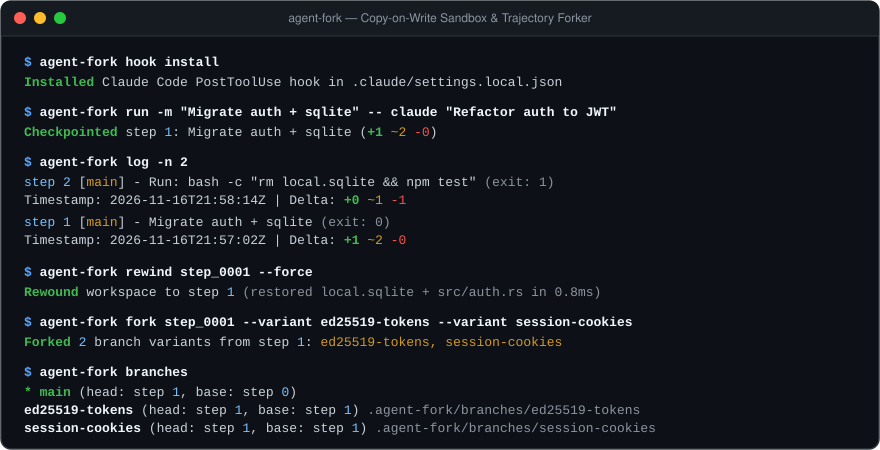

# agent-fork

Workspace checkpointing, rewind, parallel branch worktrees, and HTTP cassette recording for CLI coding agents.

[](https://github.com/abhinavm-web/agent-fork/actions/workflows/ci.yml)
[](https://github.com/abhinavm-web/agent-fork/releases)
[](LICENSE)
[](Cargo.toml)

<p align="center">
  
</p>

## Overview

Built-in agent undo commands only track edits made through the agent's own file-edit tool. When an agent runs shell commands (`npm install`, `rm`, Python scripts, SQLite migrations, or subagents), those mutations are outside internal tracking.

`agent-fork` wraps CLI agents (`claude`, `codex`, or custom scripts) with a content-addressed workspace snapshot store and a local HTTP cassette proxy:

- **Content-addressed workspace snapshots**: Indexes workspace files with `blake3` in `.agent-fork/storage` and materializes branch worktrees via `std::fs::copy` (OS kernel clones/reflinks on supported filesystems). On a 300-file workspace, incremental checkpoints take `~200 ms`, rewinds take `~250 ms`, and parallel 2-branch forks (600 files) take `~994 ms`.
- **LLM/MCP cassette proxy**: Intercepts `ANTHROPIC_BASE_URL` and `OPENAI_BASE_URL` traffic, recording request/response turns alongside each checkpoint so turns can be inspected or edited.
- **Parallel branch worktrees**: Rewind the primary workspace to an earlier step, fork isolated branch worktrees from any checkpoint, compare diffs, and promote the selected branch back to `main`.

```text
  Agent Process (claude / codex / custom script)
         |                              |
         v                              v
  +--------------+              +-------------------+
  | Local HTTP   |<------------>| Snapshot Engine   |
  | Cassette     |              | (blake3 CAS +     |
  | Proxy (Axum) |              |  kernel copy/CoW) |
  +------+-------+              +---------+---------+
         |                                |
         +--------------+-----------------+
                        v
            +-----------------------+
            | Session Timeline CLI  |
            | step_0018 --+-> run-a |
            |             +-> run-b |
            +-----------------------+
```

## Installation

Install prebuilt binaries, download an archive from [GitHub Releases](https://github.com/abhinavm-web/agent-fork/releases/latest), or build from source:

```bash
# macOS (Apple Silicon) and Linux (x86_64)
curl -fsSL https://raw.githubusercontent.com/abhinavm-web/agent-fork/main/install.sh | sh
```

```powershell
# Windows (PowerShell)
irm https://raw.githubusercontent.com/abhinavm-web/agent-fork/main/install.ps1 | iex
```

From source:

```bash
git clone https://github.com/abhinavm-web/agent-fork.git
cd agent-fork
cargo run --example showcase
cargo install --path .
```

## Usage

### Claude Code PostToolUse hook

```bash
# Register a PostToolUse hook in .claude/settings.local.json to checkpoint after Bash/Edit/Write calls
agent-fork hook install
agent-fork hook status
```

### Run an agent with snapshots and cassette recording

```bash
# Snapshot pre/post workspace state and route API calls through the local cassette proxy
agent-fork run -m "Refactor auth to JWT" -- claude "Refactor auth to JWT and migrate local sqlite db"

# Record filesystem mutations without the HTTP proxy
agent-fork run --no-proxy -- pytest -q
```

### Inspect timeline and diffs

```bash
agent-fork log
agent-fork log --json

agent-fork diff step_0001 step_0002
agent-fork diff step_0001 --stat
```

### Rewind and fork branches

```bash
agent-fork checkpoint -m "Before database migration"
agent-fork rewind step_0001 --force

# Create isolated worktrees from step 1
agent-fork fork step_0001 --variant session-cookies --variant jwt-rotation
agent-fork branches
agent-fork promote jwt-rotation --force
```

### Inspect and edit recorded cassettes

```bash
agent-fork cassette list
agent-fork cassette show <cassette-id>
agent-fork cassette edit <cassette-id> --prompt "Use Ed25519 keys instead of RS256"
```

## Benchmarks and Scope

Reproduce locally:

```bash
cargo run --release --example benchmark
```

Measured on a 300-file workspace with `blake3` content-addressed deduplication and `materialize_cow` (`fs::copy`):

| Operation | Measured Latency | Verification |
| :--- | ---: | :--- |
| Initial 300-file snapshot (`Step 0`) | 669.62 ms | `blake3` indexed |
| Incremental checkpoint (5 modified files) | 199.41 ms | Delta `+0 ~5 -0` |
| Parallel 2-branch fork (600 files) | 993.95 ms | Isolated worktrees |
| Rewind after 30 destructive file ops | 248.56 ms | 300 / 300 hashes intact (100%) |

### Scope

| Artifact / Side Effect | Captured & Rewound | Mechanism |
| :--- | :---: | :--- |
| Workspace source files, `bash` edits, build outputs | Yes | Content-addressed `blake3` CAS + worktrees |
| File-backed local databases (`SQLite`, JSON/DuckDB files in workspace) | Yes | Snapshotted on every checkpoint/rewind |
| Anthropic / OpenAI HTTP LLM and MCP turns | Yes | Recorded and editable via local Axum cassette proxy |
| Remote databases (external Postgres/Redis) and network side effects | No | External state outside workspace root |
| Live background daemons / in-memory process state | No | Process exit/restart boundary (use `hook install` per tool call) |

## Architecture

```text
src/
├── cli.rs              # Clap CLI definition and subcommands
├── error.rs            # Typed error hierarchy (AgentForkError)
├── cow/
│   ├── engine.rs       # Workspace snapshot, restore, and branch materialization
│   ├── storage.rs      # Content-addressed blake3 blob store (.agent-fork/storage)
│   ├── manifest.rs     # Per-step file metadata and hash manifests
│   ├── diff.rs         # Unified diff and line-stat computation across steps
│   └── ignore.rs       # .gitignore and sandbox exclusion filters
├── cassette/
│   ├── proxy.rs        # Axum HTTP proxy intercepting Anthropic and OpenAI turns
│   ├── store.rs        # Cassette persistence (.agent-fork/cassettes)
│   ├── edit.rs         # Turn prompt/response mutation
│   └── signature.rs    # Deterministic request fingerprinting
├── process/
│   └── runner.rs       # Child process spawning with proxy env vars
└── session/
    ├── timeline.rs     # Step history and pointer state machine
    └── branch.rs       # Isolated branch worktree management and promotion
```

## Development

```bash
cargo test
cargo clippy --all-targets -- -D warnings
```

## See Also

| Repository | Description |
| :--- | :--- |
| **[ctx-firewall](https://github.com/abhinavm-web/ctx-firewall)** | Active LLM context proxy and terminal profiler with KV-cache prefix pinning |
| **[diffmem](https://github.com/abhinavm-web/diffmem)** | Git diff-of-diffs episodic memory daemon and editor rule sync |
| **[reddiff](https://github.com/abhinavm-web/reddiff)** | Differential regression finder that emits runnable crash reproducers only |
| **[jitpipe](https://github.com/abhinavm-web/jitpipe)** | Sample-driven compiled Unix pipes (`sgrep`, `sawk`, `sjq`) |

## License

[MIT](LICENSE)
